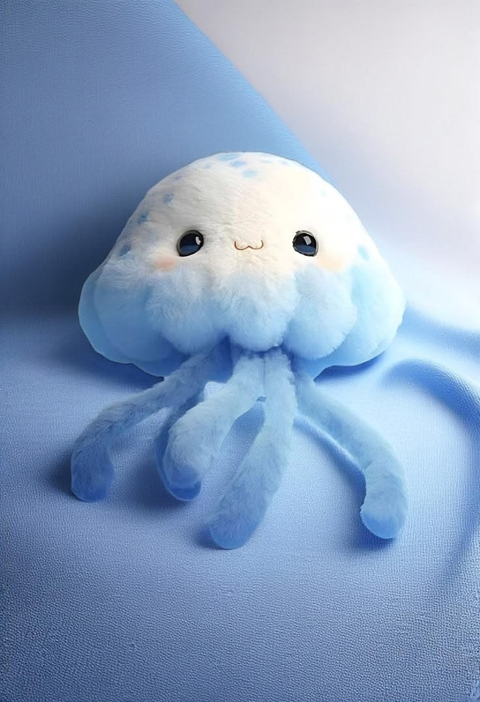

# OctoBuddy — Cute Screen Pet (Chrome Extension)

Four cute screen buddies that live inside Chrome, follow your cursor
everywhere, blink, play, fall asleep when you're idle, and jump with hearts
when you click them. Pick your pet in the popup — no reinstall needed.

## What's new in v2.0.0 — 4 pets!

- **🐙 Octopus (Ollie)** — the original: swaying tentacles, bobbing float
- **🐝 Bee (Buzzie)** — flapping wings, wiggling antennae, fast hover
- **🦎 Lizard (Lizzy)** — swaying tail, giant eyes, tongue flick every few seconds
- **🤖 MicroDuck robot (Ducky)** — ticking robot head tilt, camera eye, orange beak and feet

Every pet is drawn in SVG in the style of its reference photo, so every part
can move — a flat photo can't flap wings or wag a tail. Switch pets anytime
from the popup; the pet on your open pages changes live.

## Features

- **Follows your cursor** on every page, with smooth cute lag (not a robotic snap)
- **4 pets to choose from** (octopus, bee, lizard, MicroDuck robot) — each with
  its own moves, switchable live from the popup
- **Alive:** blinking eyes, swaying tentacles, flapping wings, wagging tail,
  ticking robot head, bobbing float, tilt toward movement
- **Idle sleep:** no mouse movement for 20 seconds → Zzz mode, wakes on movement
- **Click love:** click the pet → jump + heart burst + speech bubble
- **Popup controls:** pet chooser, on/off, pet name, size (60–140px), follow speed
- **Private:** no tracking, no data leaves your browser. Settings stay in
  `chrome.storage.sync` only.

## Install (2 minutes)

1. Download or clone this repo, unzip if needed.
2. Open Chrome → `chrome://extensions`
3. Turn on **Developer mode** (top right).
4. Click **Load unpacked** → select this folder.
5. Open any website — your buddy appears near your cursor. Click the extension
   icon to change name, size or speed.

Works in Chrome, Edge, Brave and any Chromium browser. (Firefox needs a
Manifest V2 port — contributions welcome.)

## Why the permissions?

- **"Read and change all your data on all websites"** — this is how Chrome
  phrases content-script injection. OctoBuddy only adds one floating pet element
  to each page. It never reads page content, passwords, or history.
- **Storage** — only for your settings (name, size, speed, on/off).

## Customize (make it yours)

- **Pet look:** edit `pet.css` + the SVGs inside `pets.js` (colors, size, speed).
  `content.js` is only the shared engine — it doesn't draw anything.
- **Pet name:** change it in the popup — the greeting bubble uses it.
- **Your own skin:** replace `assets/octopus-plush.jpg` with your own art.
  A transparent PNG cutout works best as a pet sprite (see Roadmap).
- **Behavior:** idle-sleep time is `20000` ms in `content.js` — change it freely.

## Roadmap

- Transparent-PNG photo skin option (use your own plush photo as the pet)
- Pet reactions to scrolling / typing / tab switching
- Desktop-app version (pet over the whole desktop, outside the browser)
- More buddies: penguin, cat, owl — and your own designs (add one to `pets.js`)

## License

MIT — free to use, remix and share. If you make a cool skin, send a pull request!

## Publish on the Chrome Web Store

1. Use the store zip (extension files with `manifest.json` at the root).
2. Go to the Chrome Web Store Developer Dashboard and pay the one-time **$5**
   developer registration fee (Google account required).
3. Upload the zip, fill in the listing (description, 128px icon, screenshots
   1280×800), and in the privacy section state: no data is collected, no remote
   code, storage is only for settings.
4. Submit for review (usually a few days). The `<all_urls>` permission is
   genuinely needed so the pet can appear on every page — say that in the
   justification.
5. After approval, anyone can search "OctoBuddy" and click **Add to Chrome**.

## Try the live demo

Open `demo.html` in any browser — no install needed. It runs the same pets
with an auto-moving demo cursor (or your own mouse) and a pet switcher, so you
can watch each one follow, blink, hop and sleep.

## Credits

Plush octopus photo by the author. Built as an open-source desktop-buddy
experiment — the software cousin of a certain crochet robot pet.
